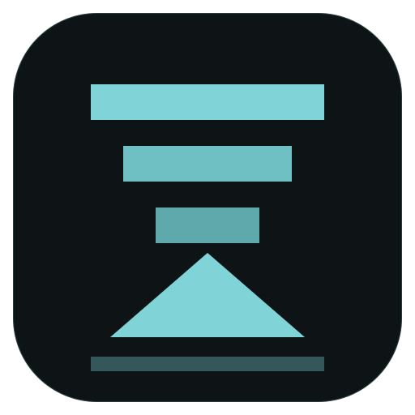

<p align="center">
  
</p>

<h1 align="center">Bye!MinecraftDownloader (BMCD)</h1>

<p align="center">
  把 Minecraft 的下载、整合包和出餐收进一个桌面应用。
</p>

<p align="center">
  <a href="https://github.com/ByeMinecraftDownloader/BMCD/releases/latest"></a>
  <a href="https://github.com/ByeMinecraftDownloader/BMCD/actions/workflows/ci.yml"></a>
  <a href="LICENSE"></a>
  
  
</p>

<p align="center">
  <a href="#功能">功能</a> ·
  <a href="#安装">安装</a> ·
  <a href="#快速开始">快速开始</a> ·
  <a href="#从源码构建">从源码构建</a> ·
  <a href="#命令行">命令行</a> ·
  <a href="#项目结构">项目结构</a>
</p>

> [!NOTE]
> 当前版本 **0.1.1**，处于小范围内测阶段，CLI、配置和整合包导出格式仍可能调整。
> 遇到问题或有建议，欢迎到 [Issues](https://github.com/ByeMinecraftDownloader/BMCD/issues) 反馈。

BMCD 是一个用 **Qt 6 / Qt Quick** 写的 Minecraft 资源下载与整合包工具。它从官方版本清单读取游戏文件，支持 Fabric、Quilt、Forge、NeoForge 加载器，也能导入 Modrinth、CurseForge、FTB 整合包，完成校验、部署、备份和导出。

界面把整个流程拆成「点菜 → 烹饪 → 出餐 → 设置」：先选版本和配菜，再下载、安装加载器，最后部署到游戏目录或打包带走。配色可跟随桌面 matugen / KDE ColorScheme，界面支持中英文。

## 功能

- **下载与校验**：官方版本清单、正式版/快照筛选、默认 6 路并行下载、断点续传、SHA-1 校验、暂停/继续/取消。
- **下载源**：可配置 Modrinth CDN、Mojang 镜像（如 BMCLAPI）、主源失败后的自动回退，以及独立的临时下载目录。
- **加载器**：Fabric、Quilt、Forge、NeoForge；按游戏版本选择加载器版本并自动安装。
- **模组菜篮**：按加载器和游戏版本检索 Modrinth 模组，加入菜篮后统一生成安装计划。
- **整合包**：导入 `.mrpack` / CurseForge zip / FTB；部署到游戏目录时使用 staging，覆盖前自动备份，失败可回滚。
- **出餐**：部署到文件夹、导出引用式 `.mrpack` / FTB，或导出带许可闸门的自包含 `.mrpack`。
- **桌面体验**：四视图界面、跟随桌面色板、中英文切换；无头命令在创建窗口前分流，适合脚本和 CI。

## 安装

### 预编译包

从 [Releases](https://github.com/ByeMinecraftDownloader/BMCD/releases/latest) 下载对应平台的包：

| 平台 | 文件 | 安装 |
|---|---|---|
| Arch Linux | `bmcd-<version>-1-x86_64.pkg.tar.zst` | `sudo pacman -U ./bmcd-*.pkg.tar.zst` |
| Debian / Ubuntu | `bmcd_<version>_amd64.deb` | `sudo apt install ./bmcd_*.deb` |
| Windows | `BMCD-Setup-<version>-x64.exe` | 双击安装，按向导完成 |
| Windows 便携版 | `BMCD-windows-x64.zip` | 解压后运行其中的 `bmcd.exe` |

Debian 包自带 `/opt/bmcd` 运行时，不要求系统另装 Qt。每个 Release 都附带 `SHA256SUMS`，下载后可校验：

```bash
sha256sum -c SHA256SUMS
```

### AppImage / Flatpak

AppImage 和 Flatpak 目前通过源码脚本构建，不随 Release 发布。AppImage 工具默认从 `.tools/` 读取，也可以通过 `BMCD_TOOLS` 指定目录。

```bash
# AppImage：需要 linuxdeploy、linuxdeploy-plugin-qt、appimagetool
packaging/build-appimage.sh
./build/BMCD-x86_64.AppImage

# Flatpak：需要 flatpak-builder 和 KDE 6.9 runtime/SDK
packaging/build-flatpak.sh                 # 构建、安装并 smoke
packaging/build-flatpak.sh --no-install    # 只构建 bundle
packaging/build-flatpak.sh --working-tree  # 用当前工作树做本地测试
```

AppImage 的发布基线是 Ubuntu 22.04 / glibc 2.35；在更新的发行版上构建会被拒绝，避免把开发机的 glibc 绑进产物。只做本地测试时可设置 `BMCD_ALLOW_NEW_GLIBC=1`。

## 快速开始

1. **点菜**：选择正式版或快照，按需选择 Fabric / Quilt / Forge / NeoForge；也可以把 Modrinth 模组加入菜篮。
2. **烹饪**：开始下载并安装加载器。支持暂停、继续和失败重试。
3. **出餐**：部署到游戏目录（自动备份），或导出 `.mrpack` / FTB / 自包含包。
4. **设置**：调整下载源、Java、临时目录、语言和配色。

## 从源码构建

依赖：

- CMake ≥ 3.21
- 支持 C++20 的编译器
- Qt ≥ 6.5：Core、Gui、Quick、Qml、Network、Concurrent、Sql、Svg、Test
- Ninja（推荐）
- zlib；Windows 没有系统 zlib 时，CMake 会自动拉取并静态链接 v1.3.1
- 可选的 onnxruntime：只用于实验性 RAG 后端，不装也能正常构建和搜索

```bash
cmake -S . -B build -G Ninja -DCMAKE_BUILD_TYPE=Release
cmake --build build
ctest --test-dir build --output-on-failure
```

无显示环境可加 `QT_QPA_PLATFORM=offscreen`。测试共 11 组，包含平台守卫、主题、下载、加载器、整合包、RAG 和离屏 UI golden 测试。

Windows 上可用 MSVC + Qt 构建，并运行 `pwsh packaging/build-windows.ps1` 生成便携 zip；macOS 目前只做编译验证，不发布安装包。

## 命令行

所有无头命令在创建窗口前分流，适合脚本和 CI。`bmcd --help` 有完整选项。

```bash
# 版本与下载
bmcd --version
bmcd --plan VERSION                  # 只打印下载计划，不落地
bmcd --download VERSION --target DIR # 下载并校验

# 整合包导入与部署
bmcd --import pack.mrpack
bmcd --import pack.mrpack --to DIR
bmcd --pack pack.json --to DIR --dry-run

# 整合包导出
bmcd --pack pack.json --format mrpack --out out.mrpack
bmcd --pack pack.json --format ftb --out out.zip
bmcd --pack pack.json --format self --out self.mrpack --licenses --confirm @project:<id>
bmcd --pack pack.json --verify DIR

# 实例与诊断
bmcd --instances
bmcd --i18n-check
bmcd --benchmark
```

`--view order|cook|serve|settings`、`--size WxH` 和 `--dump-layout` 用于界面截图与布局诊断，不改变业务行为。

<details>
<summary>实验性：本地 RAG 检索</summary>

RAG 后端默认不参与界面搜索，仅用于实验和评估：

```bash
bmcd --fetch-model
bmcd --rag-build --from-docs DIR
bmcd --ask "fabric 怎么装" --top 5
```

没有 onnxruntime 时会退回确定性的 hashing embedder 和 FTS5 索引。
</details>

## 整合包支持

| 格式 | 导入 | 说明 |
|---|---|---|
| **Modrinth** `.mrpack` | 支持 | 读取 `modrinth.index.json` 的 path/hashes/downloads/env，以及 `overrides` / `client-overrides` |
| **CurseForge** zip | 支持 | 读取 `manifest.json`；带 `url` 的文件直接使用，缺失 URL 的文件可通过 `CURSEFORGE_API_KEY` 解析 |
| **FTB** | 支持 | `manifest.json` + `overrides`，可导出引用式整合包 |
| **自包含** `.mrpack` | 导出 | 带许可闸门、NOTICE 和 `redistribution.json`，禁止再分发的文件默认不会写入 |

## 数据位置

以下是 Linux 默认路径；Windows 使用 Qt 的标准缓存/数据目录。

| 内容 | 路径 |
|---|---|
| 版本清单缓存 | `~/.cache/BMCD/bmcd/version_manifest_v2.json` |
| 下载/部署临时区 | 默认 `~/.cache/BMCD/bmcd/downloads/`；设置页可指定父目录 |
| 整合包导入 staging | `~/.local/share/BMCD/bmcd/imports/<hash>/` |
| RAG 实验索引 | `~/.cache/BMCD/bmcd/rag/index.sqlite` |
| RAG 实验模型 | `~/.cache/BMCD/bmcd/models/e5-small/` |
| 日志 | 由 `MC_LOG` 指定文件 |

## 项目结构

| 路径 | 内容 |
|---|---|
| `src/core/` | 版本清单、下载、部署、整合包与导出 |
| `src/mods/` | Modrinth 模组检索、别名与安装计划 |
| `src/theme/` | 色板读取、颜色计算与 QML tokens |
| `src/platform/` | 路径、文件操作、控制台等平台差异 |
| `src/rag/` | 实验性本地检索后端 |
| `qml2/` | Qt Quick 界面、控件与四个视图 |
| `packaging/` | Arch、Debian、Windows、AppImage、Flatpak 打包脚本 |
| `tests/` | 单元测试、UI golden 测试与 fixtures |

## 翻译

中文是源语言。修改界面文案后，用 Qt Linguist 工具刷新并编译英文目录（确保 Qt 的 `bin` 在 `PATH`）：

```bash
lupdate qml2 -ts i18n/bmcd_en.ts
lrelease i18n/bmcd_en.ts
```

`i18n/bmcd_en.qm` 会随源码提交并由 CMake 编进可执行文件，因此各平台构建不依赖 Qt Linguist。`bmcd --i18n-check` 用探针验证翻译确实被加载。

## 反馈

- Bug 和功能建议：请开 [Issue](https://github.com/ByeMinecraftDownloader/BMCD/issues)
- 提交代码前，请至少跑一遍 `ctest --test-dir build --output-on-failure`
- 打包或发布相关的改动，请同时确认 `.github/workflows/ci.yml` 和 `release.yml` 仍然通过

## 许可证

本项目以 **GNU General Public License v3.0 或更新版本（GPL-3.0-or-later）** 发布，详见 [`LICENSE`](LICENSE)。
Copyright (C) 2026 RyanZ <byeminecraftdownloader@proton.me>。

整合包导出另有许可闸门：禁止再分发的文件默认不会进入自包含包。
