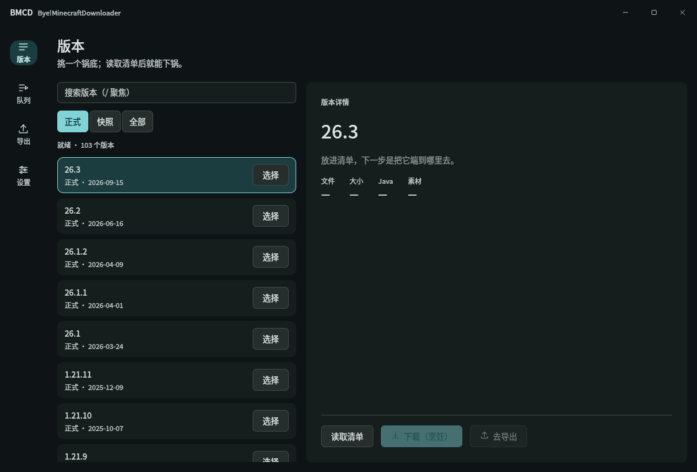
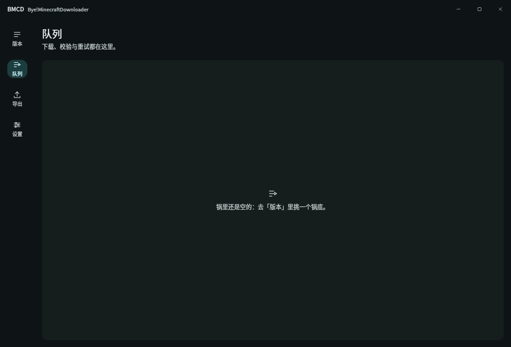
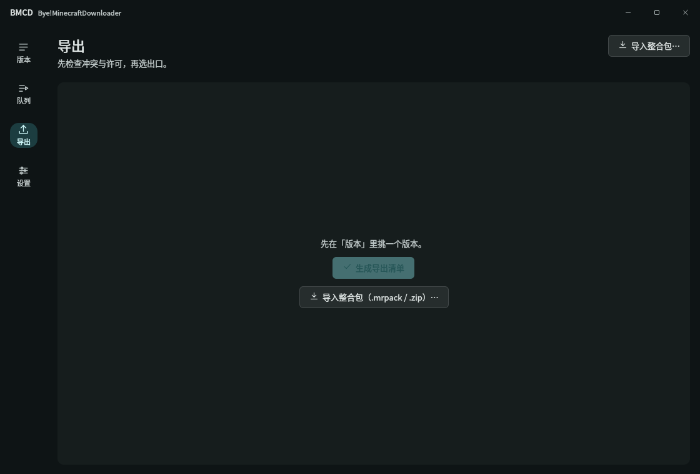
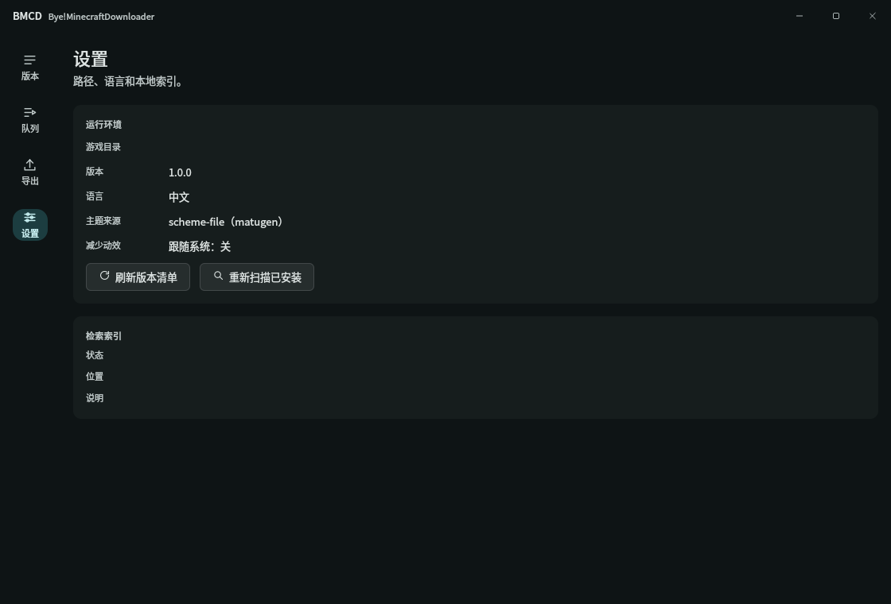

# Bye!MinecraftDownloader (BMCD) 1.0

**BMCD** 是 Qt 6 / Qt Quick 写的 Minecraft 资源下载与整合包工具：
从官方版本清单下载游戏文件，也能导入、校验、部署和导出 `.mrpack` / CurseForge / FTB 整合包。
界面按「点菜 → 烹饪 → 上菜 → 设置」四步组织，配色跟随桌面 matugen 色板。

| 点菜 | 烹饪 |
|---|---|
|  |  |
| **上菜** | **设置** |
|  |  |

## 1.0 能做什么

| 区域 | 能力 |
|---|---|
| 点菜（Order） | 版本清单（正式/快照/全部）、搜索、本地 RAG 模组提示、安装状态徽章 |
| 烹饪（Cook） | 并行下载（默认 6 并发）、断点续传、SHA-1 校验、暂停/继续/取消、失败重试 |
| 上菜（Serve） | 部署到游戏目录（staging + 原子替换 + 回滚）、导出 `.mrpack` / FTB、自包含包（许可闸门 + NOTICE + `redistribution.json`） |
| 设置（Settings） | 主题诊断、语言、版本/已安装刷新、本地检索索引状态 |
| 包生态 | 导入 `.mrpack`、CurseForge zip、FTB 包；发现 `.minecraft`（HMCL/PCL 默认目录）/ Prism / MultiMC 实例 |
| 主题 | 读取 matugen 生成的 KDE 色板 → Lab/LCh → 设计 token；色板缺失时回退内置主题 |
| 本地检索 | SQLite FTS5 + 可选 onnxruntime 向量；无模型时 hashing 降级仍可用 |
| 多语言 | 中文为源语言，内置英文 Qt Linguist 翻译（`--lang en`，或跟随系统 locale） |

界面规范见 [`docs/ui-spec-1.0.md`](docs/ui-spec-1.0.md)，版本节奏见 [`docs/roadmap-1.0.md`](docs/roadmap-1.0.md)，
RAG 评测见 [`docs/rag-eval.md`](docs/rag-eval.md)，Windows 稳定性项见 [`docs/windows-stability.md`](docs/windows-stability.md)。

## 安装与运行

### AppImage（Linux）

```bash
packaging/build-appimage.sh                 # 构建 build/BMCD-x86_64.AppImage
./build/BMCD-x86_64.AppImage
```

AppImage 自带 Qt 运行库，不包含 RAG 模型（模型可选下载：`bmcd --fetch-model`，见下文）。

### Flatpak

清单在 `packaging/flatpak/`，构建脚本 `packaging/build-flatpak.sh`，说明见 [`packaging/README.md`](packaging/README.md)。
Flatpak 需要 `flatpak-builder` 与 flathub remote；本机未安装故只做了清单与构建路径验证。

### 从源码构建

依赖：CMake ≥ 3.21、Ninja、Qt ≥ 6.5（Core/Gui/Quick/Qml/Network/Concurrent/Sql/Svg/Test）、
zlib（Linux/macOS 用系统包；Windows 没有系统 zlib 时 CMake 自动从源码拉取
v1.3.1 并静态链接）；RAG 向量检索可选 onnxruntime。

```bash
cmake -S . -B build -G Ninja -DCMAKE_BUILD_TYPE=Release
cmake --build build
ctest --test-dir build --output-on-failure
```

无显示环境可用 `QT_QPA_PLATFORM=offscreen`；golden 测试会自动以离屏方式跑一遍 qml2 界面。

## 命令行

无头子命令在创建窗口之前分流，适合脚本与 CI：

```bash
bmcd --version
bmcd --plan 26.3                     # 打印下载计划（不落地）
bmcd --download 26.3 --target DIR    # 下载并校验
bmcd --import pack.mrpack            # 只导入，打印摘要与 staging 目录
bmcd --import pack.mrpack --to DIR   # 导入 + 下载 + 部署
bmcd --pack pack.json --to DIR       # 部署既有清单（--dry-run 预检）
bmcd --pack pack.json --format mrpack --out out.mrpack
bmcd --pack pack.json --format ftb --out out.zip
bmcd --pack pack.json --format self --out self.mrpack --licenses --confirm mods/x.jar
bmcd --pack pack.json --verify DIR
bmcd --instances [--instances-root DIR]
bmcd --fetch-model                    # 下载可选 RAG 模型（约 130 MB）
bmcd --rag-build --from-docs docs
bmcd --ask "fabric 怎么装" --top 5
bmcd --i18n-check                    # 校验内置英文翻译
bmcd --benchmark                     # 首帧/RSS 性能数字（离屏）
```

`--help` 有完整选项说明。整合包导入支持：

- **Modrinth**：`modrinth.index.json`，读取 `files[]` 的 path/hashes/downloads/env 与 `overrides`/`client-overrides`；
- **CurseForge**：`manifest.json`，带 `url` 的文件直接使用；没有 URL 的文件在设置
  `CURSEFORGE_API_KEY` 后通过官方 API 解析（不设置则列入 `unresolved` 并跳过）；
- **FTB**：`manifest.json` + `overrides`。

## 数据位置

| 内容 | 路径 |
|---|---|
| 版本清单缓存 | `~/.cache/BMCD/bmcd/version_manifest_v2.json` |
| 下载/部署临时区 | `~/.local/share/BMCD/bmcd/` |
| 整合包导入 staging | `~/.local/share/BMCD/bmcd/imports/<hash>/` |
| RAG 索引 | `~/.cache/BMCD/bmcd/rag/index.sqlite` |
| RAG 模型（可选） | `~/.cache/BMCD/bmcd/models/e5-small/` |
| 日志（设置 `MC_LOG`） | 指定文件 |

## 翻译

中文是源语言。新增/修改界面文案后用 Qt Linguist 工具刷新并编译：

```bash
/usr/lib/qt6/bin/lupdate qml2 -ts i18n/bmcd_en.ts
/usr/lib/qt6/bin/lrelease i18n/bmcd_en.ts
```

编译产物 `i18n/bmcd_en.qm` 随源码提交，并由 CMake 资源编进可执行文件，
因此各平台构建不依赖 Qt Linguist；`--i18n-check` 用 6 条探针验证翻译确实被加载。

## 性能预算（1.0）

在本机（Linux, 12 核, Release, offscreen）实测：

```
benchmark: first-frame 123–138 ms, window-created 107–126 ms, rss 70 MB
```

要求为启动 < 1 s、点菜首屏 < 300 ms、RSS < 200 MB；`bmcd --benchmark` 可复现。
首屏数字是窗口创建到首帧的代理指标，不含版本清单的网络往返。

## 已知限制

- 不安装 Java，不集成 Forge/NeoForge 安装器（需要起 JVM，按路线图单独立项）。
- 不自建 mod 托管/CDN；下载地址来自官方清单或整合包元数据。
- CurseForge 无 URL 的包需要 `CURSEFORGE_API_KEY`，否则相关文件会跳过。
- RAG 模型不随包分发（AppImage 保持体积）；未下载模型时使用 hashing 降级。
- v1 单文件界面已在 1.0 移除；`qml2/` 是唯一 UI，升级见迁移指南。
- 三平台安装包由 CI 构建且未签名；本仓库只在 Linux 上做了本地构建、测试与运行验证。

## 许可证

WTFPL v2，见 [`LICENSE`](LICENSE)。整合包导出另有许可闸门：禁止再分发的文件默认不会进入自包含包。
